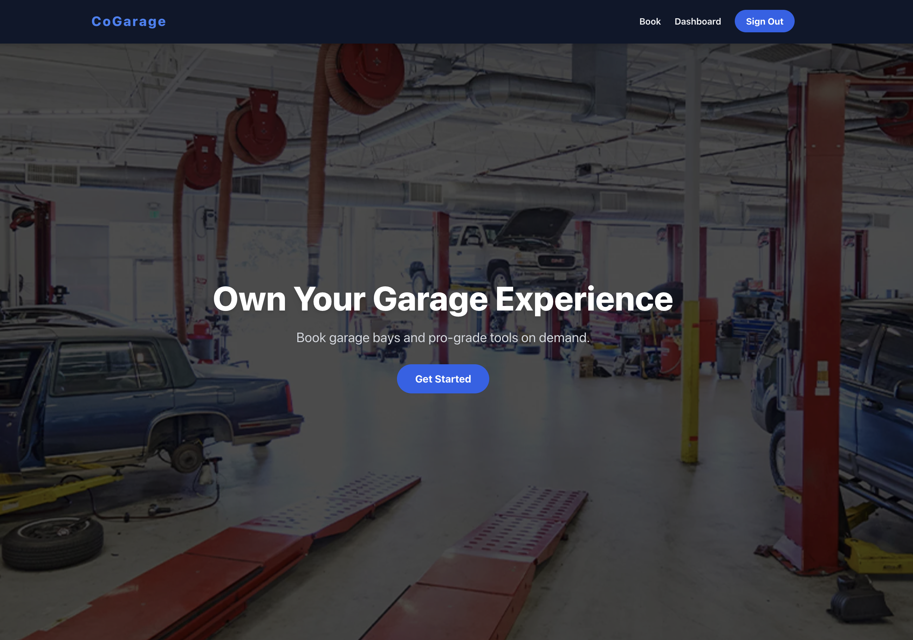
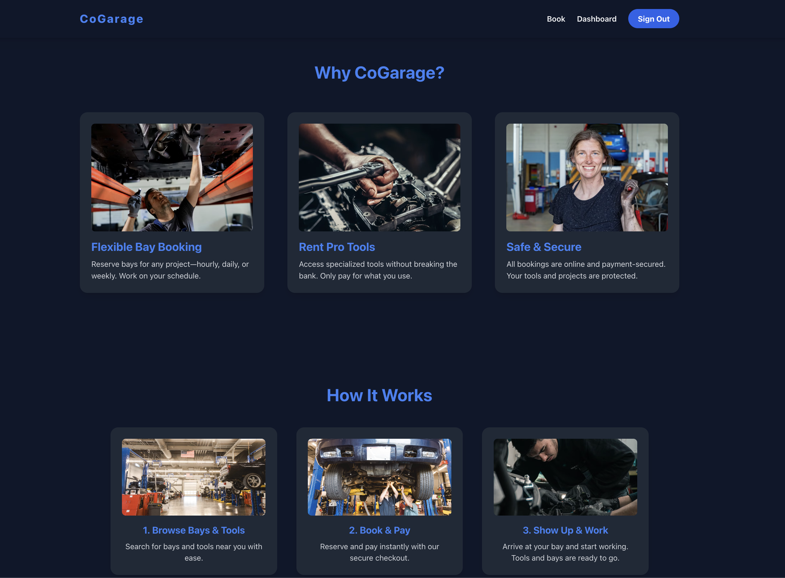
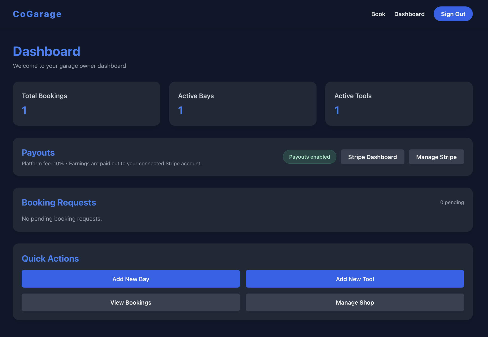
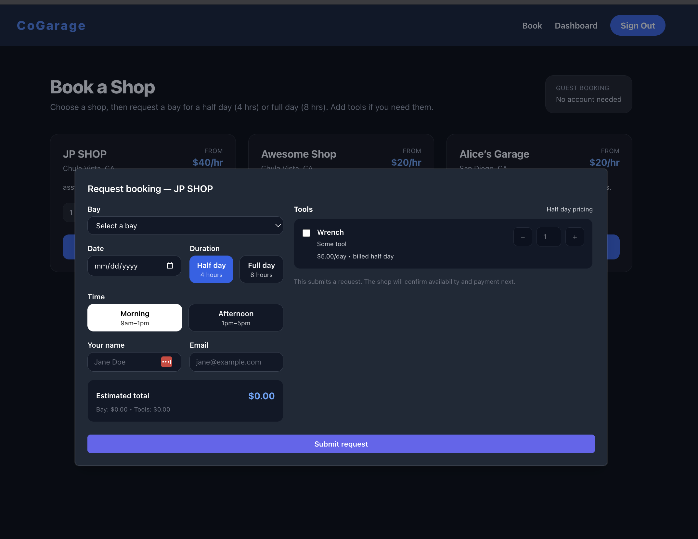
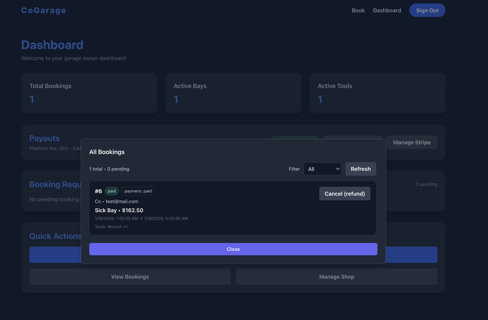

# Co-Garage

A marketplace web application where automotive shops can list available service bays and individuals can browse, book, and rent them.

## Project Structure

This is a monorepo containing:

- `backend/` - Rails 7.1 API-only application
- `frontend/` - React (Vite) with TypeScript and Tailwind CSS

## Tech Stack

### Backend
- **Framework**: Ruby on Rails 7.1 (API-only)
- **Database**: PostgreSQL
- **Authentication**: JWT (bcrypt for password hashing)
- **Testing**: RSpec

### Frontend
- **Framework**: React 18 with TypeScript
- **Bundler**: Vite
- **Styling**: Tailwind CSS
- **Routing**: React Router DOM
- **HTTP Client**: Axios

## Prerequisites

Before you begin, ensure you have the following installed:

- **Ruby 3.2.2** - Check with `ruby -v`
- **PostgreSQL** - Check with `psql --version`
- **Node.js 18+** - Check with `node -v`
- **npm or yarn** - Check with `npm -v`

## Getting Started

### Backend Setup

1. Navigate to the backend directory:
   ```bash
   cd backend
   ```

2. Install Ruby dependencies:
   ```bash
   bundle install
   ```

3. Create the PostgreSQL database:
   ```bash
   rails db:create
   ```

4. Run database migrations (when available):
   ```bash
   rails db:migrate
   ```

5. Start the Rails server:
   ```bash
   rails server
   ```

The API will be available at `http://localhost:3000`

### Frontend Setup

1. Navigate to the frontend directory (in a new terminal):
   ```bash
   cd frontend
   ```

2. Install Node.js dependencies:
   ```bash
   npm install
   ```

3. Start the development server:
   ```bash
   npm run dev
   ```

The frontend will be available at `http://localhost:5173`

## Production configuration

Production requires:

- `SECRET_KEY_BASE` or Rails credentials containing `secret_key_base`. The development JWT fallback is disabled in production.
- `DATABASE_HOST`, `DATABASE_USERNAME`, and `DATABASE_PASSWORD` for the PostgreSQL connection in `backend/config/database.yml`.
- `FRONTEND_BASE_URL`, the public frontend origin (for example, `https://cogarage.example`). It is used for Stripe Checkout and Connect return URLs.
- `STRIPE_SECRET_KEY` (or credentials containing `stripe.secret_key`) and `STRIPE_WEBHOOK_SECRET`. Configure Stripe to send `checkout.session.completed` and `account.updated` events to `/api/v1/stripe/webhook`; unsigned events are rejected.
- `SMTP_ADDRESS` and the applicable SMTP settings (`SMTP_PORT`, `SMTP_DOMAIN`, `SMTP_USERNAME`, `SMTP_PASSWORD`, `SMTP_AUTH`, and `SMTP_STARTTLS`) for booking payment emails. Email delivery is disabled when `SMTP_ADDRESS` is unset.

`PLATFORM_FEE_PERCENT` defaults to `10`. Keep secrets in the deployment environment or Rails credentials; never commit `.env` or secret values.

Build the frontend with `cd frontend && npm run build`. Serve its `dist/` assets and route `/api/v1` requests to Rails under the same public origin; the frontend uses relative `/api/v1` URLs. Production CORS permits only `FRONTEND_BASE_URL`. Set `RAILS_SERVE_STATIC_FILES=true` only when Rails should serve files from `public/`. Use HTTPS for the public origin and Stripe webhook.

## Development Workflow

1. Start PostgreSQL (if not running as a service)
2. Start the backend server (Terminal 1): `cd backend && rails server`
3. Start the frontend dev server (Terminal 2): `cd frontend && npm run dev`
4. Open your browser to `http://localhost:5173`

## Project Status

🚧 **In Development** - This project is currently being built incrementally.

## Current Features

- User authentication (shop owner / renter roles)
- Automotive shop CRUD operations
- Bay listing with availability
- Responsive owner operations dashboard with date-stamped booking requests, active bay/tool counts, Stripe payout status, and quick inventory actions. Booking history and payment-link workflows remain available from the booking desk.
- Guest booking form with half/full-day selection, optional tool quantities, and an itemized estimate. The responsive dialog keeps the request action visible; payment follows shop confirmation.
- Shop discovery on Book a Shop: case-insensitive name/location search, an optional maximum starting hourly rate, and an available-bays-only filter. Filters combine, preserve listing order, and can be cleared when no shops match. These summary filters do not check date-specific availability.
- Logged-out Features and How It Works navigation opens the matching Home section from any route, with smooth scrolling below the fixed navbar. Direct section links (`/#features`, `/#how-it-works`) and browser back/forward navigation are supported.
- Pricing per hour

## Future Features

- Bay and tool image galleries
- Advanced calendar with blocked-out dates
- Stripe Connect payout history for shop owners
- Automated reminders (email/SMS) for upcoming bookings
- Reviews and ratings for shops and bays
- Saved searches

## App Demo Photos

| Home Page | Call to Action | Dashboard |
| --- | --- | --- |
|  |  |  |

| Request Booking | Paid Booking |
| --- | --- |
|  |  |

## License

This project is private and proprietary.

# Co-Garage
